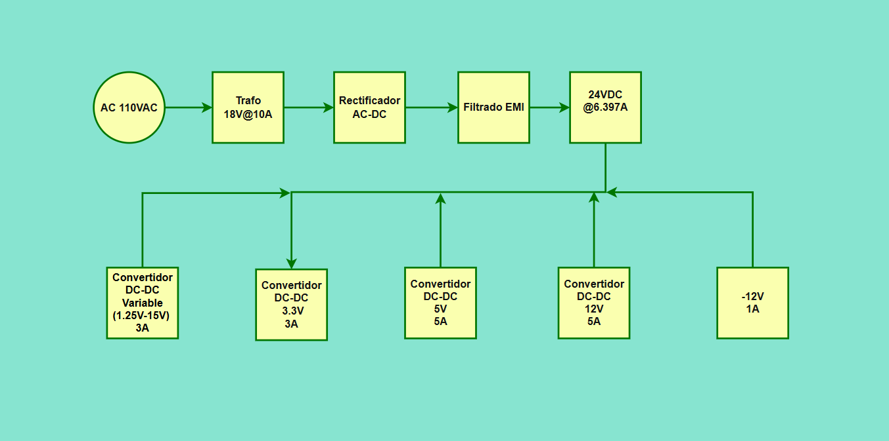
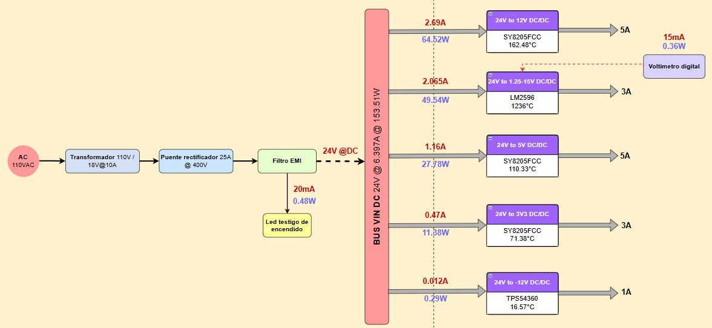

# 📚 Documentación de Ingeniería, Cálculos Térmicos y Arquitectura

**Análisis de balance energético, cálculos de disipación térmica por convertidor, hojas de datos oficiales y diagramas de arquitectura visual del sistema.**

[⬅️ Volver al README Principal](../README.md) • [🛠️ Ir a Esquemáticos y PCB (Trunk)](../PCB/Trunk/README.md)

---

## 🗂️ 1. Inventario de Archivos en `Documentation/`

Esta carpeta centraliza el análisis de potencia, requerimientos del proyecto y la arquitectura del sistema. A continuación, el detalle de cada directorio y archivo:

| Ícono | Directorio / Archivo | Formato | Función dentro del Proyecto |
| :---: | :--- | :---: | :--- |
| 📸 | **`Capture_the_buck_calculator/`** | `Carpeta` | Capturas de la calculadora en Excel (*Power Dissipation Calcu.*) que evalúa el comportamiento térmico y el consumo de corriente de cada regulador DC/DC. |
| 📄 | **`Datasheets/`** | `Carpeta` | Hojas de datos oficiales de los fabricantes para los convertidores conmutados (`SY8205FCC`, `TPS54360DDAR`, `LM2596SX-ADJ/NOPB`) y semiconductores. |
| 📐 | **`Diagrams/`** | `Carpeta` | Archivos editables y exportaciones de imagen de la arquitectura funcional (Diagrama de Bloques y Árbol de Potencia). |
| 📊 | **`Power_supply_design.xlsx`** | `Excel` | **Libro maestro de ingeniería.** Contiene especificaciones eléctricas, requisitos, restricciones de diseño PCB y la lista de materiales (BOM). |

---

## 📐 2. Diagramas de Arquitectura (`Diagrams/`)

### 🔹 Diagrama de Bloques del Sistema
*Detalla la cadena funcional desde la entrada de **18 VAC**, protecciones primarias, rectificación, filtrado EMI, hasta la partición en los 5 canales DC/DC y la instrumentación visual.*

 

### 🔹 Árbol de Potencias (Power Tree)
*Ilustra el flujo jerárquico de energía, detallando corrientes por rama, eficiencias de conversión, pérdidas estimadas y la distribución de los **151.9 W** de potencia instalada.*

---

## 🧮 3. Calculadora de Balance Energético y Térmico (`Capture_the_buck_calculator/`)

Las ecuaciones de dimensionamiento de componentes pasivos se encuentran incrustadas en los esquemáticos de Altium Designer. Para garantizar la viabilidad del diseño y evitar sobrecalentamientos, se utilizó una plantilla en Excel que evalúa las condiciones de peor caso (*Worst Out Current case*) para cada convertidor.

### 📥 Parámetros de Entrada (Input Data)
* **`Vin`:** Tensión de entrada proveniente del bus DC (ej. **24 V**).
* **`Vout`:** Tensión de salida del canal correspondiente (ej. **15 V**, **12 V**, **5 V**).
* **`Worst Out Current case`:** Corriente máxima demandada por la carga (ej. **3 A**, **5 A**).
* **`Effi`:** Eficiencia nominal del convertidor extraída del datasheet a plena carga (ej. **0.915** o **91.5%**).
* **`Thermal θJA`:** Resistencia térmica de unión a ambiente del encapsulado en **°C/W**.
* **`Temp Amb`:** Temperatura ambiente de operación (ej. **27 °C**).

### 📤 Resultados del Análisis (Output Data)
* **`Wout`** ($P_{out}$): Potencia real entregada a la carga ($V_{out} \times I_{out}$).
* **`Win`** ($P_{in}$): Potencia total demandada al bus de **24 VDC** ($W_{out} / \text{Effi}$).
* **`Wdiff`** ($P_{loss}$): Potencia disipada en forma de calor por el circuito integrado ($W_{in} - W_{out}$).
* **`Power Dis`** ($T_j$): Estimación de la temperatura de la unión térmica del chip.
* **`Iin`:** Corriente media exigida al bus principal de entrada ($W_{in} / V_{in}$). Este valor es crítico para dimensionar el banco de capacitores principal y el inductor del filtro EMI.

---

## 📊 4. Libro Maestro de Diseño (`Power_supply_design.xlsx`)

Este documento centraliza la trazabilidad completa del hardware a través de 5 pestañas técnicas interconectadas:

| Pestaña Técnica | Descripción del Contenido |
| :--- | :--- |
| **`1. Especificaciones`** | Cuadro de carga de las 5 salidas, tensiones, corrientes máximas (**17 A** acumulados), potencia total (**151.9 W**) y gráfico comparativo por canal. |
| **`2. Req. Funcionales`** | Trazabilidad de los requerimientos de diseño vinculados directamente con las topologías de los esquemáticos. |
| **`3. Req. No Funcionales`**| Reglas de interfaz de usuario: Voltímetro, LED de presencia de bus 24V y potenciómetro. |
| **`4. Restricciones`** | Reglas críticas de ruteo de pistas de PCB para soportar **6.381 A** en el bus DC y **17 A** en los planos de masa (GND). |
| **`5. Lista de Componentes`** | **BOM consolidada de 66 ítems** con designadores estandarizados bajo norma IPC, listos para ensamble. |